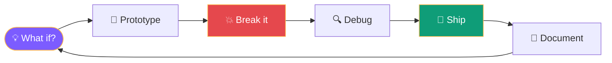

<div align="center">


<h1>Hey, I'm Krishyangi 👋</h1>


<p>
  <a href="mailto:dixitkrishyangi@gmail.com"></a>
  <a href="https://www.linkedin.com/in/krishyangi-dixit-9527ba388/"></a>
  <a href="https://github.com/Krishyangi-bit"></a>
</p>

</div>

<br/>

<h2 align="center">About Me</h2>

I'm a B.Tech Computer Science student who turns ideas into working software. I like the space where software engineering, AI, and thoughtful design meet, and I like it even more when the result is something a real person can use.

```js
const krishyangi = {
  role: "B.Tech CSE student · builder · professional debugger",
  building: ["NAVRAAH", "MindSpace", "BugSift"],
  exploring: ["AI", "NLP", "Computer Vision", "Systems"],
  learning: "Java",
  fueledBy: ["curiosity", "stack traces", "just one more fix"],
};
```

<details>
<summary><b>🔁 How I build things</b></summary>

<br/>



</details>

<br/>

<h2 align="center">Tech Stack</h2>

<table align="center">
  <tr>
    <td align="right"><b>Languages</b></td>
    <td></td>
  </tr>
  <tr>
    <td align="right"><b>Frameworks</b></td>
    <td></td>
  </tr>
  <tr>
    <td align="right"><b>Data &amp; Vision</b></td>
    <td></td>
  </tr>
  <tr>
    <td align="right"><b>Tools</b></td>
    <td></td>
  </tr>
</table>

<p align="center"><sub>Currently learning Java ☕</sub></p>

<br/>

<h2 align="center">Featured Projects</h2>

<br/>

<p align="center">
  <a href="https://github.com/Krishyangi-bit?tab=repositories"></a>
</p>

<p align="center">
An assistive navigation project that applies computer vision to help visually restricted people navigate their surroundings. A wearable prototype with a Raspberry Pi, camera, ultrasonic sensing, and haptic + audio feedback.
</p>

<p align="center">
  
  
  
  
  
  
  
  
  
  
</p>

<p align="center"><a href="https://github.com/Krishyangi-bit?tab=repositories"><b>Explore NAVRAAH →</b></a></p>

<br/>

<p align="center">
  <a href="https://github.com/Krishyangi-bit?tab=repositories"></a>
</p>

<p align="center">
An intelligent multimodal framework for predicting student burnout through temporal chat sentiment and behavioral pattern analysis.
</p>

<p align="center">
  
  
  
  
  
  
</p>

<p align="center"><a href="https://github.com/Krishyangi-bit?tab=repositories"><b>Explore MindSpace →</b></a></p>

<br/>

<p align="center">
  <a href="https://github.com/Krishyangi-bit?tab=repositories"></a>
</p>

<p align="center">
  
  
</p>

<p align="center"><a href="https://github.com/Krishyangi-bit?tab=repositories"><b>Explore BugSift →</b></a></p>

<br/>

<h2 align="center">Roadmap</h2>

- 🧱 Building stronger foundations in software engineering and computer science
- ⚡ Creating practical AI-powered applications and thoughtful user experiences
- 📐 Improving how I design, document, test, and explain the systems I build
- 🌍 Growing a portfolio that shows curiosity, technical depth, and real-world problem-solving

<br/>

<h2 align="center">Connect</h2>

<p align="center">Always happy to connect with people who enjoy building, learning, and solving interesting problems.</p>

<p align="center">
  <a href="mailto:dixitkrishyangi@gmail.com"></a>
  <a href="https://www.linkedin.com/in/krishyangi-dixit-9527ba388/"></a>
</p>

<p align="center"><i>Curious by default. Builder by choice. Debugger by necessity.</i></p>


