<h1>Hey, I'm Krishyangi 👋</h1>

  
  
  
  

"Curious by default. Builder by choice. Debugger by necessity."
  

---
<h2 align="center">Right Now</h2>
<table width="100%">
  <tr>
    <td width="50%" valign="top">
      <h4>🔭 Building</h4>
      <b>NAVRAAH</b>: a wearable assistive-navigation prototype 
      <b>MindSpace</b>: student burnout prediction 
      <b>BugSift</b>: less time chasing bugs
    </td>
    <td width="50%" valign="top">
      <h4>🌱 Learning</h4>
      Java, data structures &amp; algorithms, and how to make AI models run on small hardware
    </td>
  </tr>
  <tr>
    <td valign="top">
      <h4>🤝 Looking for</h4>
      Internships, collaborations, and interesting problems worth losing sleep over
    </td>
    <td valign="top">
      <h4>💬 Ask me about</h4>
      Computer vision on a Raspberry Pi, hardware debugging, and building student-led projects
    </td>
  </tr>
</table>

⚡ Fun fact: my first hardware build taught me that one missing voltage divider can fry a Raspberry Pi. Now it's the first thing I check.

<b>🔁 How I build things (click to expand)</b>

 

---
<h2 align="center">Tech Stack</h2>

  

---
<h2 align="center">Featured Projects</h2>
<table width="100%">
  <tr>
    <td>
      <h3>🧭 NAVRAAH</h3>
      <i>Navigation Assistant For Visually Restricted And Aided Humans</i> 
      Technology with a purpose. Independence through innovation.
        
      
         

      <ul>
        <li>Wearable assistive prototype that applies <b>computer vision</b> (YOLOv8 exported to ONNX, OpenCV) to help visually restricted people understand their surroundings.</li>
        <li>Measures obstacle distance with an <b>HC-SR04 ultrasonic sensor</b> on the Raspberry Pi's GPIO, using a voltage divider to protect the 3.3V pins.</li>
        <li>Alerts the user through <b>haptic feedback</b> (transistor-driven vibration motor) and <b>audio output</b> (speaker with an amplifier).</li>
        <li>Battery-powered and packed into a compact enclosure with only the camera exposed.</li>
      </ul>
      <a href="https://github.com/Krishyangi-bit?tab=repositories"><b>View repository →</b></a>
    </td>
  </tr>
  <tr>
    <td>
      <h3>🧠 MindSpace</h3>
      <i>Understanding student well-being through data and intelligence</i>
        
      
     

      <ul>
        <li>Intelligent <b>multimodal framework</b> that predicts student burnout.</li>
        <li>Reads <b>temporal chat sentiment</b>, so it tracks how mood changes over time, not just a single snapshot.</li>
        <li>Combines sentiment with <b>behavioral pattern analysis</b> for a fuller picture of well-being.</li>
        <li>Built as a Python and Flask web application.</li>
      </ul>
      <a href="https://github.com/Krishyangi-bit?tab=repositories"><b>View repository →</b></a>
    </td>
  </tr>
  <tr>
    <td>
      <h3>🐞 BugSift</h3>
      <i>Less time chasing bugs. More time building better software.</i>
        
      
 

      <a href="https://github.com/Krishyangi-bit?tab=repositories"><b>View repository →</b></a>
    </td>
  </tr>
</table>
---
<h2 align="center">GitHub Presence</h2>
<table align="center">
  <tr>
    <td align="center"></td>
    <td align="center"></td>
  </tr>
</table>

  

<h3 align="center">🐍 Contribution Snake</h3>

  <picture>
    <source media="(prefers-color-scheme: dark)" srcset="https://raw.githubusercontent.com/Krishyangi-bit/Krishyangi-bit/output/github-snake-dark.svg" />
    <source media="(prefers-color-scheme: light)" srcset="https://raw.githubusercontent.com/Krishyangi-bit/Krishyangi-bit/output/github-snake.svg" />
    
  </picture>

---
<h2 align="center">Where This Is Going</h2>
🧱 Stronger foundations in software engineering and computer science
⚡ Practical AI-powered applications with thoughtful design
📐 Better design, documentation, testing, and explanation of everything I build
🌍 A portfolio that shows curiosity, technical depth, and real-world problem-solving
---

<h2>Let's Connect</h2>
Always happy to connect with people who enjoy building, learning, and solving interesting problems.

  
  

