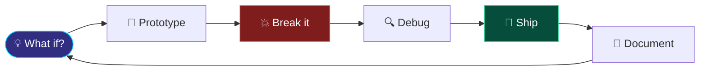

<div align="center">


# Hey, I'm Krishyangi 👋

**Engineer at Heart | Software, AI & Systems That Solve Real Problems**


<p>
  <a href="mailto:dixitkrishyangi@gmail.com"></a>
  <a href="https://www.linkedin.com/in/krishyangi-dixit-9527ba388/"></a>
  <a href="https://github.com/Krishyangi-bit"></a>
</p>


</div>

I'm a B.Tech Computer Science student who enjoys turning ideas into working software. I like the space where software engineering, AI, and thoughtful user experiences meet.

- 🔭 Building projects that connect technology to real-world problems
- 🤖 Exploring AI, natural language processing, and computer vision
- 🛠️ Learning by building, testing, debugging, and iterating
- 🎨 Into interactive web experiences and design-led development
- 🌱 Strengthening my engineering fundamentals and learning Java

> *I don't just want to make things that work. I want to understand why they work, and how to make them better.*

<div align="center">

**🔁 My build loop**




**Languages & Web Fundamentals**
<p align="center">
  
  
  
  
  
</p>

**Frontend & Design**
<p align="center">
  
  
</p>

**Backend, Data & Tools**
<p align="center">
  
  
  
  
  
  
  
</p>

**Currently Learning**
<p align="center">
  
</p>


<a href="https://github.com/Krishyangi-bit"></a>

<p align="center">
  
  
  
  
  
  
  
  
  
  
</p>

<a href="https://github.com/Krishyangi-bit"><b>Explore NAVRAAH →</b></a>

<br/>

<a href="https://github.com/Krishyangi-bit"></a>

<p align="center">
  
  
  
  
  
  
</p>

<a href="https://github.com/Krishyangi-bit"><b>Explore MindSpace →</b></a>

<br/>

<a href="https://github.com/Krishyangi-bit"></a>

<p align="center">
  
  
</p>

<a href="https://github.com/Krishyangi-bit"><b>Explore BugSift →</b></a>


<sub>These cards use third-party services and may occasionally be unavailable. Language statistics reflect repository code, not personal proficiency.</sub>


</div>

- 🧱 Building stronger foundations in software engineering and computer science
- ⚡ Creating practical AI-powered applications and thoughtful user experiences
- 📐 Improving how I design, document, test, and explain the systems I build
- 🌍 Growing a portfolio that shows curiosity, technical depth, and real-world problem-solving

<details>
<summary><b>🎮 Click for an easter egg</b></summary>

<br/>

```python
def debug(bug):
    while bug.exists():
        stare_at_screen()
        add_print_statement()
        bug = bug.hiding_somewhere_else()
    return "it was a missing semicolon"
```

</details>

<div align="center">


I'm always happy to connect with people who enjoy building, learning, and solving interesting problems.

<p align="center">
  <a href="mailto:dixitkrishyangi@gmail.com"></a>
  <a href="https://www.linkedin.com/in/krishyangi-dixit-9527ba388/"></a>
</p>

*Curious by default. Builder by choice. Debugger by necessity.*


</div>
